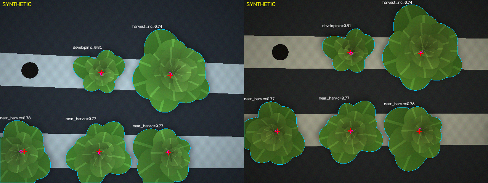
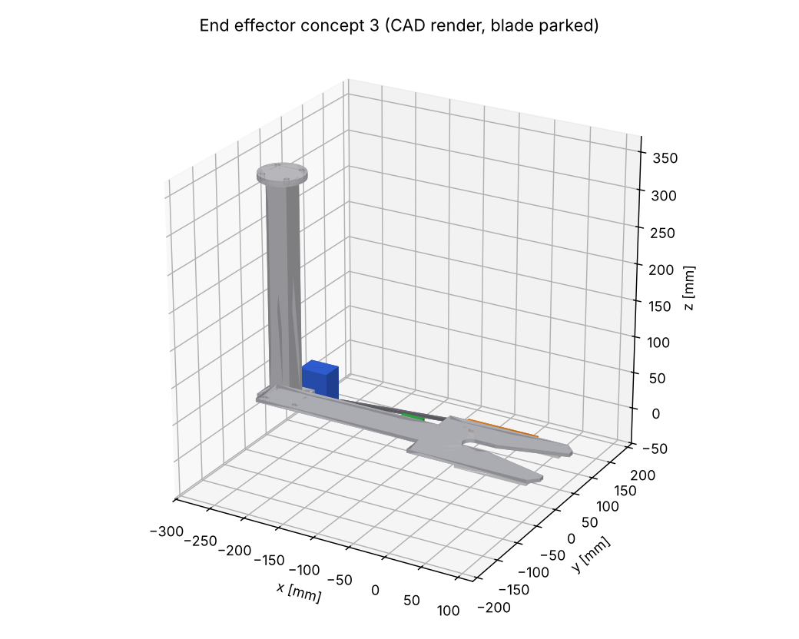
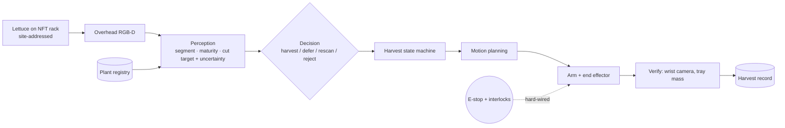

# HARVEST-X

**An open research platform for autonomous lettuce harvesting in controlled-environment agriculture.**

[](https://github.com/shrestharupeshh/harvest-x/actions/workflows/ci.yml)


> **Read this first.** HARVEST-X is at the start of its life. What exists today is the research
> foundation, the system architecture, and a tested perception library evaluated **only on
> synthetic data**, and a first-iteration mechanical design (parametric CAD of one end
> effector plus analytical sizing). There are no electronics, no firmware, no robot and no
> physical experiment yet. Every number in this repository is labelled *simulated*, *estimated* or
> *measured*; at present all of them are *simulated*. See [`PROJECT_STATUS.md`](PROJECT_STATUS.md).

## Overview

HARVEST-X aims to design, simulate, build and experimentally validate a robot that identifies
harvest-ready hydroponic lettuce, locates the cutting region, plans a collision-free approach,
stabilises and cuts the plant, collects it, verifies the outcome and logs everything against a
persistent plant identity. It is developed as a research instrument: each subsystem exists to
answer a measurable question, with baselines, uncertainty and negative results reported.



*Output of the current perception pipeline on two **synthetic** frames: instance outlines,
predicted maturity, target confidence, estimated cutting target (red) and true stem
(magenta). These are procedurally generated images, not photographs.*

## Objectives

1. A reproducible, open hardware + software platform for lettuce-harvesting research.
2. Uncertainty-aware perception: maturity, 3D cutting target, explicit confidence, and the
   ability to refuse.
3. A controlled comparison of end-effector concepts with plant damage as an outcome.
4. Evidence on whether closed-loop, perception-guided harvesting beats a fixed sequence.
5. Publishable results backed by pre-declared protocols and honest statistics.

## What works today

| Capability | State |
|---|---|
| Procedural RGB-D rack simulator with 3D stem ground truth | Implemented, tested |
| Plant detection / instance segmentation (classical baselines) | Tested on synthetic data |
| Maturity classification and fresh-mass regression baselines | Tested on synthetic data |
| Cutting-target estimation, fixture prior, fusion, calibrated uncertainty | Tested on synthetic data |
| Rule-based harvest decision with refusal | Tested on synthetic data |
| Benchmark with plant-level splits and cluster-bootstrap CIs | Implemented, in CI |
| Literature review, gap analysis, research questions | First pass |
| Architecture trade study, requirements, diagrams | v0.1 |
| Manipulator and end-effector decisions (gantry, cradle fork, side entry) | Decided, documented |
| End-effector CAD (STEP/STL), interference and reach checks | Implemented, never built |
| Sizing calculations (cutting, structure, axes, bolts, cycle) | Estimates, unit-tested |
| Harvest state machine with simulated gantry and fork (dry-run default, e-stop, sensor gate, retry) | Tested in simulation |
| Integrated simulation: perception → decision → harvest sequence | Tested in simulation |
| Gantry detail, drawings, BOM, electronics, firmware, ROS 2, Gazebo twin, dashboard | **Not started** |
| Hardware, real data, physical experiments | **None** |

### First findings (simulated)

From [`perception/results/synthetic_v0/REPORT.md`](perception/results/synthetic_v0/REPORT.md)
(150 trays, 300 images, 30 held-out test trays):

- With depth and known plant sites, instance segmentation is nearly solved in the simulator
  (F1 0.998). Colour-only segmentation misses red-leaf cultivars almost entirely (recall 0.02).
- **The fixture prior beats vision for stem localisation.** Canopy-based estimates err by
  15–25 mm on average because the stem is hidden and plants lean; the known net-pot position
  alone gives 8.1 mm (95 % CI 7.6–8.5), and fusing it with RGB-D improves that only to
  7.5 mm (7.0–7.9). 81 % of fused targets fall within the provisional 10 mm tolerance.
- The fused target's uncertainty is calibrated on average (94.4 % coverage of the nominal
  95 % region) but hardly varies between plants, so gating on it did not improve decisions.
  That is a negative result and it is reported as such.
- RGB-D features raise 5-class maturity macro-F1 from 0.63 (canopy-diameter rule) to 0.75;
  adding plant age and cultivar gives 0.78. Intervals overlap; no significance is claimed.

These numbers depend on assumed simulator parameters (stem scatter, lean, calibration error).
Their value is that they turn "does vision add anything over the fixture?" into a concrete
experiment and identify what to measure first on real plants.

## Mechanical concept



*CAD render from the parametric model, not a photograph. Blue and green boxes reserve space
for the blade gearmotor and wrist camera.*

The perception result drives the mechanics. Since the stem cannot be seen from above, the
tool tolerates the error instead: a flat fork slides along the channel top under the leaves
from a plant-free flank, a V-shaped throat guides the stem into a seat, a light beam across
the seat confirms the stem is there, and one blade sweeps across it. The channel sets the cut
height, the fork carries the cut head, and the shank and actuator stay outside the canopy. A
4-axis Cartesian gantry moves the tool. In a simulated geometric study this approach puts 29 %
of leaf area and 1 % of inner leaves in the tool path, against 72–76 % and 79–98 % when
descending through the canopy. In the integrated simulation
([`simulation/results/harvest_sim_v0/REPORT.md`](simulation/results/harvest_sim_v0/REPORT.md),
32 attempts on 30 held-out trays), a blade-only tool with 5 mm of capture fires blind on 38–81 %
of attempts depending on the target source; with 15 mm or more of capture and the fixture
prior or fusion target every attempted stem was seated, and the stem-seated sensor turned the
remaining blind cuts into harmless misses. Cutting and damage are not simulated.

None of this has been tried on a plant; the open risks and
all estimates are in [`docs/mechanical/mechanical_design.md`](docs/mechanical/mechanical_design.md).

## System architecture

Selected by documented trade studies: a **stationary 4-axis gantry over one rack section**,
whose X axis becomes the rail when the system is extended along a row. A mobile manipulator
and articulated arms were evaluated and not chosen.



Details: [`docs/architecture/system_architecture.md`](docs/architecture/system_architecture.md)
(system, mechanical, electrical, software, data-flow, state-machine and frame diagrams),
[`architecture_trade_study.md`](docs/architecture/architecture_trade_study.md),
[`system_requirements.md`](docs/architecture/system_requirements.md).

**Hardware architecture (planned):** aluminium-extrusion frame carrying a 2 x 3-site NFT rack
module, camera/light bridge, the gantry, interchangeable end effectors on a standard tool
flange, and a collection tray on a load cell; 24 V motor bus behind a hard-wired
safety relay, a real-time MCU for motion and safety, and a main computer running ROS 2.

**Software architecture (planned):** ROS-independent libraries (perception exists) wrapped by
`harvest_x_*` ROS 2 packages over `ros2_control`, so simulated and real hardware share the
same high-level interfaces.

## Research questions

| | Question | Evidence so far |
|---|---|---|
| RQ-A | Can vision (plus plant records) determine harvest readiness? | Simulated baselines |
| RQ-B | How accurately can the occluded cutting target be located, and is the uncertainty honest? | Simulated baselines |
| RQ-C | Which end-effector concept cuts cleanly with least damage? | None |
| RQ-D | Does uncertainty-gated, closed-loop harvesting beat a fixed sequence? | Simulated rule baseline (negative) |
| RQ-E | System-level success, damage, cycle time, energy | None |

Hypotheses and metrics: [`research/research_questions.md`](research/research_questions.md).
Background: [`literature_review.md`](research/literature_review.md),
[`research_gap_analysis.md`](research/research_gap_analysis.md),
[`related_systems_comparison.md`](research/related_systems_comparison.md),
[`bibliography.bib`](research/bibliography.bib) (each entry carries a verification flag).

## Roadmap

| Phase | Content | State |
|---|---|---|
| 0 | Research foundation, architecture | Done (first pass) |
| 1 | Perception and evaluation on synthetic data | Done; real-data and learned models next |
| 2 | Mechanical design: gantry, end effectors, rack, calculations | First iteration done; gantry detail and bench tests next |
| 3 | Digital twin: URDF, Gazebo, MoveIt 2 | Planned |
| 4 | Electronics and firmware | Planned |
| 5 | Integrated ROS 2 software, state machine, dashboard | Planned |
| 6 | Prototype build package | Planned |
| 7 | Physical validation | Requires hardware and plants |
| 8 | Publication | After measured evidence |

Full detail in [`ROADMAP.md`](ROADMAP.md); decisions in [`DECISIONS.md`](DECISIONS.md); open
work in [`TASKS.md`](TASKS.md) and [`NEXT_STEPS.md`](NEXT_STEPS.md).

## Repository structure

```
harvest-x/
├── research/        literature review, gap analysis, comparison table, questions, bibliography
├── docs/architecture/   trade study (YAML + generated results), requirements, diagrams
├── perception/      harvestx_perception library, benchmark, results/synthetic_v0
├── mechanical/      design parameters, harvestx_mech calculations and approach study
├── harvesting/      harvest state machine, simulated gantry/tool, integrated study
├── simulation/      results of the integrated harvest simulation
├── cad/             CadQuery models, build script, STEP/STL/SVG exports
├── docs/mechanical/ design rationale, trade studies, generated calculation reports
├── data/            dataset registry, collection protocol (no data committed)
├── tools/utilities/ trade-study tool
├── tests/           unit and integration tests
├── electronics/ firmware/ ros2_ws/ dashboard/ experiments/ procurement/
│                    status notes only: not started
└── PROJECT_STATUS · ROADMAP · DECISIONS · KNOWN_LIMITATIONS · TASKS · NEXT_STEPS ·
    HARDWARE_BUILD_CHECKLIST · CHANGELOG · CONTRIBUTING · LICENSING · SECURITY
```

## Installation

Python ≥ 3.10 on Linux or macOS.

```bash
git clone https://github.com/shrestharupeshh/harvest-x.git
```

```bash
cd harvest-x
```

```bash
python -m venv .venv
```

```bash
. .venv/bin/activate
```

```bash
pip install -e ".[dev]"
```

## Running

Perception benchmark on synthetic scenes (about six minutes on four cores):

```bash
python -m harvestx_perception.benchmark --out perception/results/synthetic_v0
```

Mechanical calculations, approach study and CAD (CAD needs `pip install -e ".[cad]"`):

```bash
python -m harvestx_mech.report
```

```bash
python -m harvestx_mech.approach_study
```

```bash
python cad/scripts/build_cad.py
```

Integrated harvest simulation (about three minutes):

```bash
python -m harvestx_harvest.study
```

Regenerate the architecture trade study:

```bash
python tools/utilities/trade_study.py docs/architecture/trade_study.yaml -o docs/architecture/trade_study_results.md
```

**Simulation:** there is no Gazebo / MoveIt 2 digital twin yet. What exists is the
perception-level scene generator and a kinematic harvest simulation (gantry timing and
geometric stem capture; cutting and damage are not modelled).

## Datasets

No data are stored in Git. [`data/dataset_registry.csv`](data/dataset_registry.csv) lists
public lettuce datasets with licences, sizes, limits and how each fact was checked;
[`data/README.md`](data/README.md) explains usage rules. No public dataset with neighbouring
plants *and* stem ground truth was found, hence the simulator and the planned collection
described in [`data/data_collection_protocol.md`](data/data_collection_protocol.md).

## Testing

```bash
ruff check perception mechanical harvesting cad tools tests
```

```bash
pytest
```

60 tests (geometry, metrics, simulator consistency, pipeline contract, decision logic, trade
study, mechanical calculations, CAD validity and interference, the harvest state machine and
its safety behaviour, and end-to-end smoke tests of the benchmark and the harvest study). CI runs them on Python 3.10 and 3.12 and
checks that the committed trade-study report matches its inputs.

## Experimental protocol

Not yet written. Principles already fixed: the plant is the experimental unit; splits are by
plant or sowing batch; final evaluation uses unseen plants; analyses and exclusion criteria
are declared in advance; failures are reported. See
[`research/research_questions.md`](research/research_questions.md).

## Hardware requirements

None to run the current software. The physical prototype is not specified beyond
[`system_requirements.md`](docs/architecture/system_requirements.md); the bill of materials
will follow the mechanical and electrical design. The physical work that only a person can do
is listed in [`HARDWARE_BUILD_CHECKLIST.md`](HARDWARE_BUILD_CHECKLIST.md).

## Safety

The intended machine has a powered blade. Requirements S-01 to S-07 call for a hard-wired
emergency stop, a guarded blade, interlocks, a firmware watchdog, reduced-power homing, a
"cut armed" flag that defaults to off, and no autonomous cutting during commissioning. None
of this has been built or validated, and no regulatory or food-contact compliance is claimed.

## Known limitations

See [`KNOWN_LIMITATIONS.md`](KNOWN_LIMITATIONS.md). In short: synthetic data only, assumed
simulator parameters, a first-pass literature review without full-text access, and no
hardware.

## Licence and citation

Software Apache-2.0, hardware designs CERN-OHL-P-2.0, documentation CC-BY-4.0
([`LICENSING.md`](LICENSING.md)). Cite via [`CITATION.cff`](CITATION.cff).
