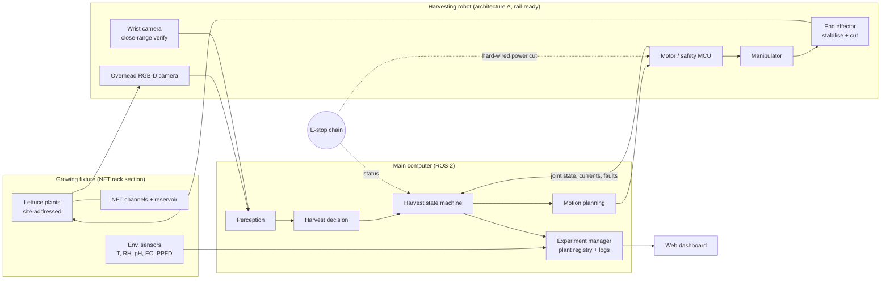
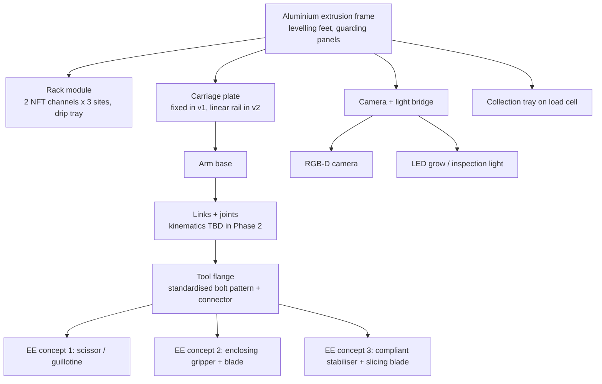
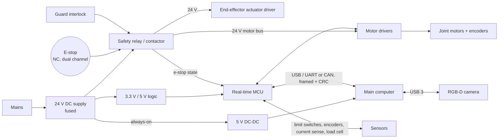
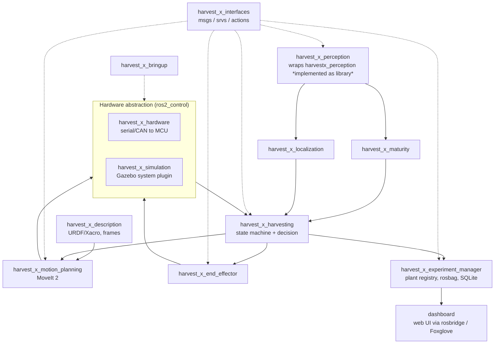
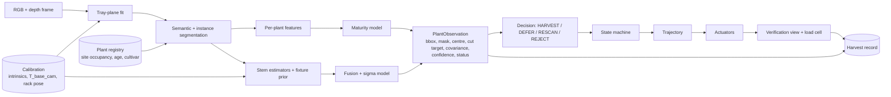
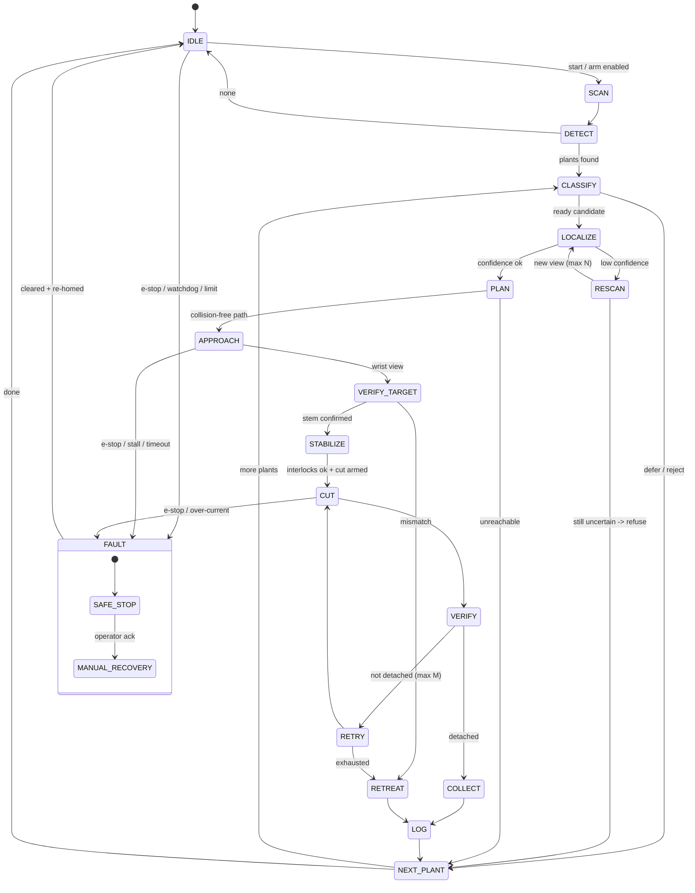
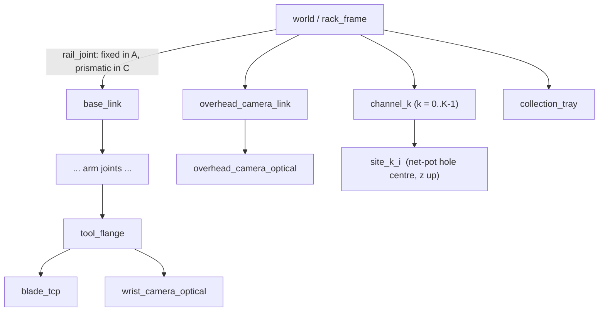

# System architecture

Status: v0.1 design intent (2026-11-15). Only the perception blocks marked *implemented* exist
as code today; everything else is planned. Diagrams are Mermaid sources and render on GitHub.

## 1. System overview

## 2. Mechanical architecture

## 3. Electrical architecture (preliminary)

Principles: logic power stays up when motor power is cut so the fault can be reported; the
E-stop chain is hard-wired and never depends on software; cutting-actuator power sits behind
both the safety relay and a separate software arming signal. Component selection and PCB
decisions are Phase 4 work.

## 4. Software architecture

The high-level nodes talk only to `ros2_control` interfaces and `harvest_x_interfaces`, so
simulated and real hardware are interchangeable. The Python library `harvestx_perception` is
ROS-independent by design so that it can be tested and benchmarked without a ROS installation.

## 5. Data flow

## 6. Control flow (harvest state machine)

Every state has a timeout. `CUT` is reachable only when the hardware safety chain is closed,
the guard is closed and a separate "cut armed" flag has been set by the operator; that flag is
off by default and stays off during commissioning.

## 7. Coordinate frames

Conventions: SI units; REP-103 axes (x forward, y left, z up) for body frames; optical frames
x right, y down, z forward; `T_a_b` maps coordinates from `b` to `a`. The cutting plane is
`site z = cut_height` above the channel surface. Calibration products: camera intrinsics,
`T_rack_camera`, `T_rack_base`, hand-eye `T_flange_wristcam`.

## 8. Sensor and actuator interfaces (preliminary)

| Device | Measures / does | Why needed | Interface (planned) | Rate |
|---|---|---|---|---|
| Overhead RGB-D camera | Colour + depth of the rack section | Detection, maturity, coarse target | USB 3 → ROS 2 image topics | 5–30 Hz |
| Wrist RGB camera | Close view under the canopy | Verify stem before cutting (RQ-B/D) | USB → ROS 2 | 15–30 Hz |
| Joint encoders | Joint position | Closed-loop motion, repeatability | MCU timers / driver feedback | ≥ 1 kHz |
| Limit / home switches | End of travel | Homing and hard limits | MCU GPIO, NC wiring | event |
| Motor current sense | Phase/bus current | Stall and collision detection, energy per harvest | MCU ADC or driver telemetry | ≥ 1 kHz |
| Blade actuator current / force | Cutting effort | Cut detection, blade wear, RQ-C | MCU ADC | ≥ 1 kHz |
| Load cell (tray) | Harvested mass | Verification + ground truth for RQ-A | HX711-class ADC → MCU | 10–80 Hz |
| E-stop + guard interlock | Operator safety | Removes motor/blade power | Hard-wired safety relay; status to MCU | event |
| Environment sensors | Air T/RH, solution T/pH/EC, light | Growing-condition covariates | I²C/1-Wire → logger | ≤ 1 Hz |
| Joint motors + drivers | Motion | – | Step/dir or CAN (Phase 4 decision) | – |
| Blade + stabiliser actuators | Cut and hold | – | PWM/servo or DC driver via MCU | – |

Message-level definitions (`harvest_x_interfaces`) will mirror
`harvestx_perception.pipeline.PlantObservation`.
