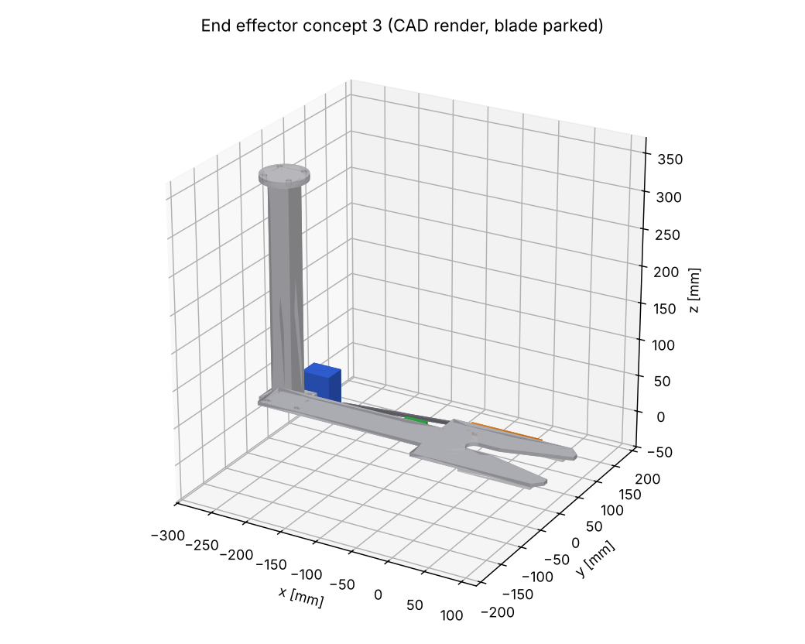
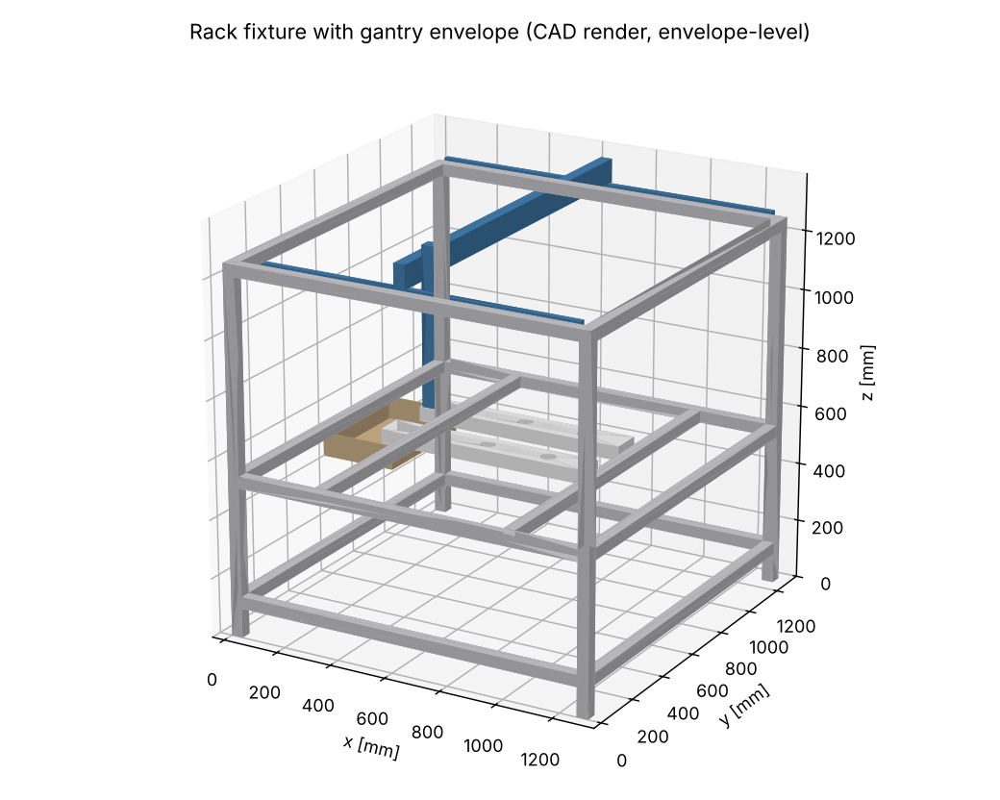

# Mechanical design (Phase 2, first iteration)

Status: **Implemented as parametric CAD and analytical estimates. Nothing has been built or
tested on hardware.** Regenerate everything with:

```bash
python cad/scripts/build_cad.py
```

```bash
python -m harvestx_mech.report
```

```bash
python -m harvestx_mech.approach_study
```

All dimensions come from [`mechanical/design_params.yaml`](../../mechanical/design_params.yaml),
where each value is tagged A (assumed), D (design choice) or S (standard).



*CAD render generated from the parametric model (not a photograph). Blue and green boxes are
space reservations for the blade gearmotor and the wrist camera, not specific products.*

## 1. The problem as a mechanical one

1. The stem is hidden under the canopy and its position is known only to about ± 20 mm
   (3 sigma, from fixture geometry; perception adds little in simulation).
2. The saleable product is the foliage itself, so anything that passes through the canopy or
   squeezes the head risks damage. The only field-tested lettuce robot reported a high damage
   rate with a gripping end effector.
3. The channel top is a flat, rigid surface a known distance below the cut.

The design therefore (a) uses the channel as a mechanical height datum, (b) tolerates lateral
error mechanically instead of demanding it from perception, and (c) keeps hardware out of the
canopy.

## 2. Design decisions

### 2.1 Approach: side entry under the canopy

A geometric study with the rosette model ([`approach_study.md`](approach_study.md), SIMULATED,
rigid leaves, upper bound on contact) compares three approaches for near-harvest butterhead:

| Approach | Leaf area in tool path | Inner leaves (heart) in tool path |
|---|---|---|
| Top-down onto the stem | 76 % | 98 % |
| Descend through the canopy beside the stem | 72 % | 79 % |
| Side entry with a low-profile head | 29 % | 1 % |

Side entry is adopted. It needs a plant-free flank beside each channel, so the rack is laid
out two channels deep with 300 mm of clear flank on each outer side, and the tool yaws 180° to
serve the second channel. This follows the "simplify the task" recommendation of the
harvesting-robot literature: the growing fixture is designed for the robot. Cost: floor area.

### 2.2 End effector: cradle fork with pivoting slicing blade (concept C3)

Three concepts were compared ([`end_effector_trade_results.md`](end_effector_trade_results.md);
judgement scores, C3 ranks first in 98 % of perturbed trials):

| Concept | Idea | Main weakness |
|---|---|---|
| C1 scissor / guillotine | Blade pair closes on the stem from the side | Nothing holds the head; it falls or needs a second device |
| C2 enclosing gripper + blade | Fingers surround the head from above, blade underneath | Maximum foliage contact; most actuators; hardest to clean |
| **C3 cradle fork + slicing blade** | Flat fork slides along the channel under the leaves; a V-throat guides the stem to a seat; one blade sweeps across | Head is retained only by gravity and the fork |

How C3 works:

- **Height datum.** UHMW-PE skids ride on the channel top. Blade plane is 11 mm above the
  channel (6 mm skid + 5 mm plate); the plate underside clears a net-pot lip of up to 5 mm
  (assumed, to be measured). Cut height does not depend on gantry Z accuracy; the Z axis only
  needs a compliant or force-limited touchdown.
- **Lateral self-centring.** The throat is 70 mm wide at the tine tips and narrows to a
  22 mm slot. With a 20 mm stem the usable half-width is 25 mm, about 4 sigma of the
  fixture-prior error. The tool, not the camera, absorbs the stem scatter.
- **Verification.** A through-beam sensor shines through a 3 mm cross-hole in the plate
  across the seat. The blade may fire only when the beam is interrupted, which is the direct
  stem observation that perception cannot provide (`VERIFIED` target status). A low wrist
  camera on the boom gives a second, visual check.
- **Cut.** A flat blade pivots through 85° across the slot against the fork edge (scissor
  action with a sliding component). The cutting force is internal to the tool. The parked
  blade sits under a guard on one tine; no edge is exposed outside the stroke.
- **Carry.** After the cut the head rests on the two tines and is lifted straight up.
- **Everything bulky stays outside the canopy.** Head, boom and camera are 25 mm tall. The
  shank, tool flange and blade gearmotor sit 240 mm behind the head, beyond the maximum canopy
  radius; a pull rod along the boom drives the blade.

### 2.3 Manipulator: 4-axis Cartesian gantry (resolves D-010)

Required motion is three translations plus yaw about the vertical: the cut plane is
horizontal, plants sit on a planar grid, and entry is along ±y. Comparison
([`kinematics_trade_results.md`](kinematics_trade_results.md)): gantry 4.60, SCARA 3.35,
commercial 6-DOF cobot 3.30, custom articulated arm 1.95; the gantry ranks first in all
perturbed trials.

Reasons: stiff and accurate at the tool, trivial kinematics and planning, fits the low
headroom between tiers of a vertical rack where an articulated arm cannot work, and its X axis
is the "rail" of the selected system architecture, so scaling means a longer X axis. A
purpose-built articulated arm would consume the project and perform worse. With no budget
constraint the axes are commercial linear modules with closed-loop drives; engineering effort
goes into the end effector, fixture, sensing and experiments.

The tool flange uses a 4 x M6 pattern on a 50 mm pitch circle (the ISO 9409-1-50-4-M6 pattern
used by many collaborative arms; verify against the standard before manufacture), so the same
end effector can be mounted on a cobot by labs that have one.

## 3. Calculations

Full generated report: [`engineering_calculations.md`](engineering_calculations.md)
(ESTIMATED, closed-form, unit-tested formulas).

| Item | Result | Note |
|---|---|---|
| Stem cut force, straight-chop upper bound | 110 N | Shear strength 0.35 MPa is a placeholder; measure it |
| Blade actuator torque (SF 2) | 9.2 N·m | Drives the choice of a gearmotor with linkage rather than a hobby servo |
| Blade bending | FoS 3.8 | After iterating the section from 18 x 0.6 mm (FoS 1.5) to 22 x 1.0 mm |
| Tines carrying the head | FoS 38 | |
| Boom | FoS 6.4, 2.1 mm free-air sag | Acceptable; a rib would stiffen it |
| Lateral deflection at the seat, 10 N | 0.42 mm | Bending + torsion; guides not included |
| Y bridge, 1.22 m span | 0.15 mm deflection, FoS 85 | Hollow-rectangle idealisation of the extrusion |
| Axis motor torque incl. SF 2 | X 2.7, Y 1.1, Z 0.26 N·m | Z needs a brake |
| Flange bolts | FoS 58 on proof load | |
| Kinematic cycle estimate | about 11 s | Motion limits only; not a throughput claim |

Not yet analysed: fatigue, blade edge loading and buckling, guide and bearing life (needs
catalogue ratings of selected parts), bolted-joint preload, frame modal behaviour, thermal or
washdown effects. No finite-element analysis has been run.

## 4. Materials, hygiene and manufacturing notes

| Part | Material (intent) | Process | Notes |
|---|---|---|---|
| Fork plate with boom | 5 mm austenitic stainless sheet | Laser or waterjet, deburr, bead-blast | Tine tips to get a 15° lead-in bevel on top (not modelled); 3 mm cross-hole for the beam is a long drilled hole, alternative is a milled groove with cover |
| Blade | Hardened stainless blade steel, 1 mm | Purchased blank or wire-EDM, ground edge | Replaceable; held by the pivot shoulder screw |
| Blade guard | 1.5 mm stainless | Laser + fold | Mandatory before any blade is fitted |
| Skids | UHMW-PE 6 mm | Milled or cut | Wear part |
| Shank, flange | 6061-T6 | Saw + mill | Outside the product zone |
| Pull rod | 4 mm stainless | Purchased rod, rod ends | |

Product-contact parts (fork, blade, skids) come off with four screws for cleaning. Material
names state intent only: **no food-contact compliance is claimed** until grades, surface
finish and supplier declarations are checked against the applicable regulations.

Critical dimensions: slot width 22 +0.5/0 mm; blade-to-fork clearance 0.05–0.15 mm (shimmed);
skid underside flatness 0.2 mm over the head; flange hole pattern ± 0.1 mm. Fasteners: A2-70
stainless, M5 for the shank foot and pivot, M6 at the flange.

## 5. Fixture



Envelope-level model: 1300 x 1300 x 1250 mm extrusion frame, two 100 x 50 mm channels with
three 50 mm sites at 220 mm pitch, channel top at 600 mm, cross members under the channels,
collection tray, camera bridge, and the gantry rails, bridge and Z ram drawn as plain bars.
Linear guides, drives, reservoir, pump, lighting, guarding panels and cable routing are not
modelled yet.

## 6. Open risks to settle on the bench before detailing further

1. **Head stability on the fork** after the cut (toppling during lift). Mitigation options:
   raised tine rails, a light top hold-down, or tilting the fork back a few degrees.
2. **Leaves trapped in the cut path.** Low outer leaves lying on the channel may be cut with
   the stem; whether that matters depends on trimming practice.
3. **Net-pot lip and plug height** variation against the 11 mm cut plane.
4. **Actual cutting force** and the benefit of the slicing angle.
5. **Stem lean:** a stem that leaves the net pot at an angle may not seat.
6. **Root pull-out:** friction during the cut could lift the net pot.

Items 1–5 can be tested with a hand-held fork and blade on real plants before any gantry
exists (checklist A5).

## 7. Deliverables in `cad/exports/`

`end_effector_concept3.step`, `rack_fixture.step`, per-part STL for the end effector, top-view
SVGs (blade open and closed), `custom_parts.csv` and `mass_properties.json` (end effector
1.77 kg including assumed allowances for the gearmotor and camera). There are no dimensioned
manufacturing drawings and no exploded views yet.
