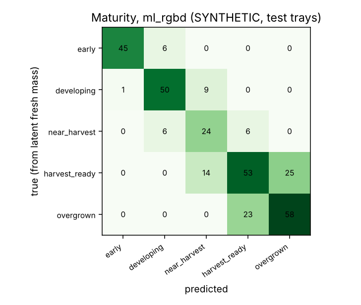

# Perception benchmark report — SYNTHETIC DATA ONLY

> **All numbers below come from the procedural simulator** (`harvestx_perception.synthetic`). They verify the software and rank baselines; they are **not** evidence of real-world performance. No real plant was imaged.

- Generated by `python -m harvestx_perception.benchmark` at commit `7a9b06c`
- Seed 20261115, 150 trays x 2 views (300 images, 1652 plant instances); tray-level split train/val/test = {'train': 90, 'val': 30, 'test': 30}
- Confidence intervals: 95 % cluster bootstrap over test trays.

## 1. Detection / instance segmentation (test trays, IoU 0.5)

| semantic | markers | P | R | F1 | AP50 | AP50:95 | mIoU (matched) | red-leaf recall |
|---|---|---|---|---|---|---|---|---|
| exg | auto | 0.731 | 0.806 | 0.767 | 0.610 | 0.542 | 0.947 | 0.02 |
| exg | sites | 0.814 | 0.796 | 0.805 | 0.701 | 0.665 | 0.972 | 0.02 |
| depth | auto | 0.890 | 0.997 | 0.940 | 0.890 | 0.745 | 0.921 | 0.98 |
| depth | sites | 0.991 | 0.988 | 0.989 | 0.978 | 0.892 | 0.947 | 0.98 |
| fusion | auto | 0.878 | 0.997 | 0.934 | 0.881 | 0.754 | 0.938 | 0.98 |
| fusion | sites | 0.991 | 0.988 | 0.989 | 0.978 | 0.916 | 0.966 | 0.98 |

## 2. Cutting-target localisation (test trays, matched plants only)

Tolerance 10 mm (assumed blade capture tolerance).

| method | modality | n | mean [mm] (95 % CI) | median | p95 | within tol |
|---|---|---|---|---|---|---|
| centroid | RGB + plane | 320 | 18.1 (16.0–20.6) | 15.1 | 39.2 | 0.26 |
| dt_peak | RGB + plane | 320 | 18.8 (16.7–21.2) | 16.1 | 36.9 | 0.22 |
| centroid_3d | RGB-D | 320 | 16.7 (14.5–18.9) | 13.3 | 36.2 | 0.29 |
| height_apex | RGB-D | 320 | 25.1 (21.9–28.6) | 20.5 | 56.7 | 0.19 |
| site_prior | fixture geometry only | 320 | 8.6 (7.7–10.0) | 7.9 | 13.2 | 0.72 |
| fusion | centroid_3d + fixture | 320 | 8.1 (7.2–9.4) | 6.9 | 13.3 | 0.81 |

Injected calibration error (1-sigma, assumed): camera-to-base 2 mm / 0.3 deg, rack-to-base 2 mm; stem scatter inside the net pot 6 mm per axis.

Calibrated sigma model (fit on training trays): `{'centroid': 0.1924, 'dt_peak': 0.1947, 'centroid_3d': 0.1779, 'height_apex': 0.2717, 'site_prior': 0.0082}`. Vision method fused with the site prior, selected on validation trays: `centroid_3d` (validation mean error mm: {'centroid': 10.9, 'dt_peak': 10.8, 'centroid_3d': 10.8, 'height_apex': 11.3}).
Selected method `fusion`: empirical coverage of the nominal 95 % region = **0.972**; confidence ECE = 0.168.

## 3. Maturity classification (5 classes, test trays)

Labels are defined from latent fresh mass, not from appearance.

| variant | model | acc (95 % CI) | macro-F1 (95 % CI) | ECE | ready P / R |
|---|---|---|---|---|---|
| rule_diameter_px (RGB) | thresholds | 0.625 (0.52–0.73) | 0.618 (0.51–0.71) | 0.375 | 0.63 / 0.41 |
| rule_diameter_m (RGB-D) | thresholds | 0.637 (0.54–0.73) | 0.633 (0.52–0.71) | 0.363 | 0.70 / 0.42 |
| ml_rgb | logreg | 0.625 (0.54–0.73) | 0.638 (0.54–0.71) | 0.064 | 0.55 / 0.39 |
| ml_rgbd | logreg | 0.719 (0.65–0.80) | 0.728 (0.65–0.78) | 0.032 | 0.65 / 0.58 |
| ml_rgbd+metadata | rf | 0.812 (0.74–0.88) | 0.819 (0.73–0.87) | 0.069 | 0.78 / 0.70 |

## 4. Fresh-mass regression (random forest, test trays)

| features | MAE [g] | MAPE | R² |
|---|---|---|---|
| rgb | 20.7 | 0.257 | 0.884 |
| rgbd | 16.6 | 0.173 | 0.921 |

## 5. Harvest decision (perception-only upper bound, ideal manipulator)

Actions on test detections: `{'DEFER': 206, 'RESCAN': 31, 'REJECT': 83}`; truly harvest-ready: 92.

| policy | harvest attempts | correct | wrong maturity | mislocalised | precision | recall of ready |
|---|---|---|---|---|---|---|
| naive_harvest_if_predicted_ready | 82 | 40 | 29 | 13 | 0.49 | 0.43 |
| rule_based_with_refusal | 0 | 0 | 0 | 0 | nan | 0.00 |

## 6. Runtime

Full pipeline: 183 ms per 640x480 frame (single CPU thread of the CI container; not an embedded-target measurement).

## Figures

