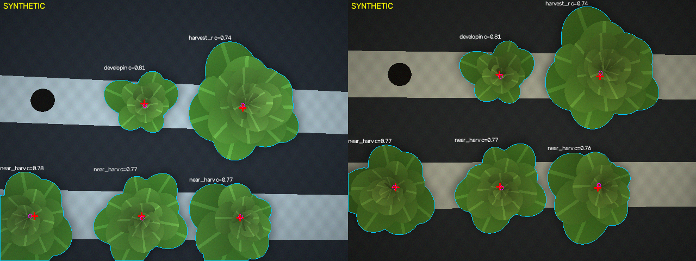
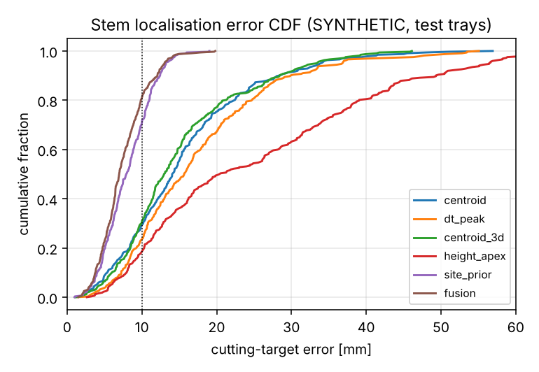

# Perception benchmark report — SYNTHETIC DATA ONLY

> **All numbers below come from the procedural simulator** (`harvestx_perception.synthetic`). They verify the software and rank baselines; they are **not** evidence of real-world performance. No real plant was imaged.

- Generated by `python -m harvestx_perception.benchmark` at commit `9c3c893`
- Seed 20261115, 150 trays x 2 views (300 images, 1652 plant instances); tray-level split train/val/test = {'train': 90, 'val': 30, 'test': 30}
- Confidence intervals: 95 % cluster bootstrap over test trays.

## 1. Detection / instance segmentation (test trays, IoU 0.5)

| semantic | markers | P | R | F1 | AP50 | AP50:95 | mIoU (matched) | red-leaf recall |
|---|---|---|---|---|---|---|---|---|
| exg | auto | 0.731 | 0.806 | 0.767 | 0.610 | 0.542 | 0.947 | 0.02 |
| exg | sites | 0.820 | 0.802 | 0.811 | 0.714 | 0.640 | 0.957 | 0.02 |
| depth | auto | 0.890 | 0.997 | 0.940 | 0.890 | 0.745 | 0.921 | 0.98 |
| depth | sites | 1.000 | 0.997 | 0.998 | 0.997 | 0.864 | 0.932 | 1.00 |
| fusion | auto | 0.878 | 0.997 | 0.934 | 0.881 | 0.754 | 0.938 | 0.98 |
| fusion | sites | 1.000 | 0.997 | 0.998 | 0.997 | 0.885 | 0.951 | 1.00 |

## 2. Cutting-target localisation (test trays, matched plants only)

Tolerance 10 mm (assumed blade capture tolerance).

| method | modality | n | mean [mm] (95 % CI) | median | p95 | within tol |
|---|---|---|---|---|---|---|
| centroid | RGB + plane | 323 | 15.7 (14.3–17.2) | 14.0 | 33.9 | 0.29 |
| dt_peak | RGB + plane | 323 | 17.4 (16.0–19.0) | 15.7 | 36.8 | 0.24 |
| centroid_3d | RGB-D | 323 | 15.2 (13.6–16.8) | 13.0 | 33.4 | 0.31 |
| height_apex | RGB-D | 323 | 25.1 (22.1–28.5) | 20.4 | 56.4 | 0.19 |
| site_prior | fixture geometry only | 323 | 8.1 (7.6–8.5) | 7.9 | 13.2 | 0.71 |
| fusion | centroid_3d + fixture | 323 | 7.5 (7.0–7.9) | 6.9 | 13.0 | 0.81 |

Injected calibration error (1-sigma, assumed): camera-to-base 2 mm / 0.3 deg, rack-to-base 2 mm; stem scatter inside the net pot 6 mm per axis.

Calibrated sigma model (fit on training trays): `{'centroid': 0.1648, 'dt_peak': 0.1655, 'centroid_3d': 0.1546, 'height_apex': 0.2449, 'site_prior': 0.0065}`. Vision method fused with the site prior, selected on validation trays: `centroid_3d` (validation mean error mm: {'centroid': 7.4, 'dt_peak': 7.3, 'centroid_3d': 7.3, 'height_apex': 7.7}).
Selected method `fusion`: empirical coverage of the nominal 95 % region = **0.944**; confidence ECE = 0.051.

## 3. Maturity classification (5 classes, test trays)

Labels are defined from latent fresh mass, not from appearance.

| variant | model | acc (95 % CI) | macro-F1 (95 % CI) | ECE | ready P / R |
|---|---|---|---|---|---|
| rule_diameter_px (RGB) | thresholds | 0.616 (0.52–0.72) | 0.617 (0.52–0.70) | 0.384 | 0.63 / 0.41 |
| rule_diameter_m (RGB-D) | thresholds | 0.628 (0.53–0.73) | 0.631 (0.52–0.71) | 0.372 | 0.68 / 0.43 |
| ml_rgb | rf | 0.659 (0.58–0.74) | 0.680 (0.59–0.74) | 0.063 | 0.59 / 0.55 |
| ml_rgbd | rf | 0.740 (0.67–0.81) | 0.753 (0.66–0.81) | 0.060 | 0.68 / 0.64 |
| ml_rgbd+metadata | rf | 0.765 (0.68–0.84) | 0.782 (0.70–0.84) | 0.054 | 0.70 / 0.61 |

## 4. Fresh-mass regression (random forest, test trays)

| features | MAE [g] | MAPE | R² |
|---|---|---|---|
| rgb | 21.7 | 0.266 | 0.874 |
| rgbd | 17.3 | 0.179 | 0.914 |

## 5. Harvest decision (perception-only upper bound, ideal manipulator)

Truly harvest-ready plants among test detections: 94. A harvest counts as correct only if the plant is truly harvest-ready AND the target error is within tolerance. P(harvest_ready) threshold fixed at 0.6.

| policy | harvest attempts | correct | wrong maturity | mislocalised | precision | recall of ready |
|---|---|---|---|---|---|---|
| naive: harvest if predicted ready | 88 | 44 | 28 | 16 | 0.50 | 0.47 |
| rule + refusal, confidence >= 0.5 | 29 | 12 | 9 | 8 | 0.41 | 0.13 |
| rule + refusal, confidence >= 0.6 | 29 | 12 | 9 | 8 | 0.41 | 0.13 |
| rule + refusal, confidence >= 0.7 | 29 | 12 | 9 | 8 | 0.41 | 0.13 |
| rule + refusal, confidence >= 0.8 | 0 | 0 | 0 | 0 | nan | 0.00 |

Actions by confidence threshold: `{'0.5': {'DEFER': 195, 'HARVEST': 29, 'RESCAN': 17, 'REJECT': 82}, '0.6': {'DEFER': 195, 'HARVEST': 29, 'RESCAN': 17, 'REJECT': 82}, '0.7': {'DEFER': 195, 'HARVEST': 29, 'RESCAN': 17, 'REJECT': 82}, '0.8': {'DEFER': 195, 'RESCAN': 46, 'REJECT': 82}}`.

## 6. Runtime

Full pipeline: 210 ms per 640x480 frame (single CPU thread of the CI container; not an embedded-target measurement).

## Figures

